# Ubuntu Server Administration on AWS

**Author:** Abel Mesfin

## Project Overview

In this project, I set up and managed an Ubuntu Linux server on AWS EC2. I set it up the way a university IT team might run a lab server, with separate access for faculty, students, and IT staff. I'm doing this project to get hands-on practice with Linux administration, which comes up in almost every IT support and cloud job posting I've looked at.

## Tools and Concepts

I used Amazon EC2, Ubuntu Server 26.04 LTS, and the Linux command line over SSH. Some of the key concepts I learned include patching and updates, firewalls, users and groups, file permissions, running a web service, and scheduling scripts with cron. I also ran into a few real problems along the way and documented how I troubleshot them.

**Services:** Amazon EC2 · AWS Budgets · AWS Security Groups
**Tools:** Ubuntu 26.04 LTS · SSH · apt · UFW · Nginx · Bash · cron · systemctl · journalctl

---

## 1. Securing the AWS Account

### What I did in this step
Before launching anything, I secured my AWS account. I turned on MFA (multi-factor authentication) and set up a zero-spend budget alert.

### Why this matters
The root account has full control over everything, including billing. With MFA, someone would need my phone and my password to get in, not just the password. The budget alert emails me if anything starts costing money, so I don't get surprised by a bill.

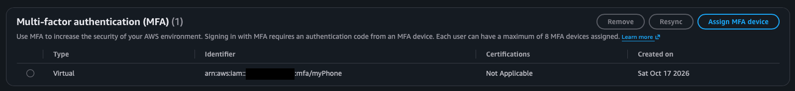
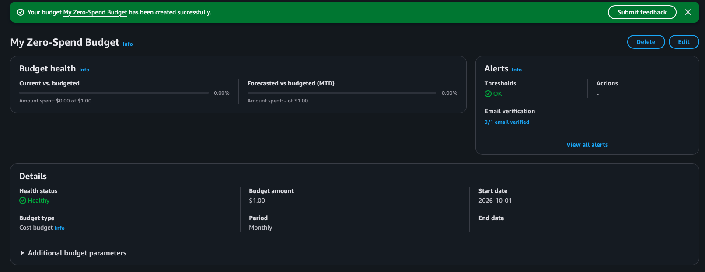

---

## 2. Launching the Server

### What I did in this step
In this step, I launched an EC2 instance running Ubuntu Server 26.04 LTS.

| Setting | What I chose |
|---|---|
| Instance type | `t3.micro` (free tier) |
| Region | US West (Oregon) |
| Login | RSA key pair (`ubuntu-lab-key`) |
| SSH access | My IP only |

### Understanding the setup
An EC2 instance is basically a virtual computer running in Amazon's data center. I picked an LTS (long-term support) version of Ubuntu since it gets security updates for years, which is why organizations usually go with LTS. I limited SSH to my IP so the server isn't open to login attempts from the whole internet.

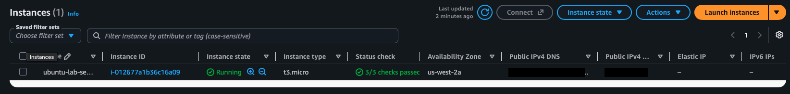

---

## 3. Connecting with SSH

### What I did in this step
In this step, I connected to the server from my Mac's Terminal using SSH and the key file AWS gave me.

```bash
chmod 400 ~/Downloads/ubuntu-lab-key.pem
ssh -i ~/Downloads/ubuntu-lab-key.pem ubuntu@<server-ip>
```

### Understanding SSH keys
Instead of a password, SSH uses a key pair. The public key lives on the server and the private key (the `.pem` file) stays on my computer. I had to run `chmod 400` on the key first because SSH won't use a private key that other users could read.

Once I was in, the login screen showed the server's disk usage (30.5%), memory usage (26%), and its private IP inside AWS.

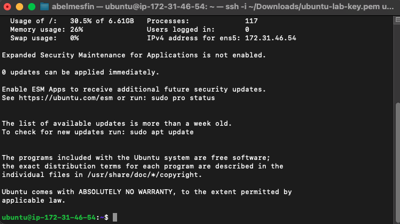

---

## 4. Updating the System

### What I did in this step
In this step, I installed all available updates and rebooted the server.

```bash
sudo apt update
sudo apt upgrade -y
sudo reboot
uname -r
```

### Why this matters
Most attacks go after known vulnerabilities that already have a fix, so keeping a system patched is one of the most important things you can do. After upgrading, the output said a new kernel was installed and needed a reboot to take effect. After rebooting, I used `uname -r` to confirm the new kernel (`7.0.0-1014-aws`) was running and checked that no reboot was still pending.

One thing I noticed is that disk usage went from 30.5% to 39.6% after the updates. On a small server like this one that's worth keeping an eye on.

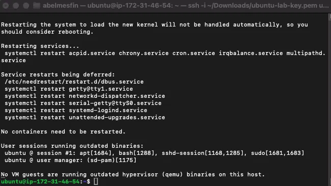
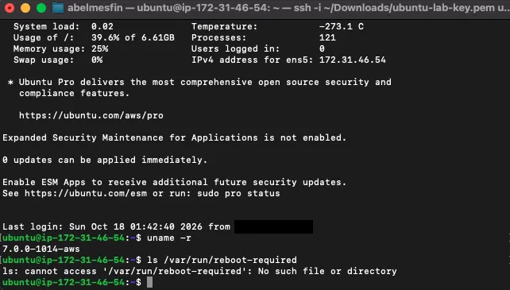

---

## 5. Firewall and Automatic Updates

### What I did in this step
In this step, I turned on UFW, which is a firewall that runs on the server itself, and checked that automatic security updates were running.

```bash
sudo ufw allow OpenSSH
sudo ufw allow http
sudo ufw enable
sudo ufw status verbose
```

### Understanding the two firewalls
AWS already has a firewall in front of the server (the security group). UFW adds a second layer on the server itself, so if one of them is set up wrong the other one still protects it. I made sure to allow SSH before turning UFW on, otherwise I would have locked myself out.

UFW is set to block all incoming traffic by default and only let in what I allowed, which is SSH (port 22) and HTTP (port 80). I also confirmed `unattended-upgrades` was running, so security updates get installed automatically in between my manual updates.

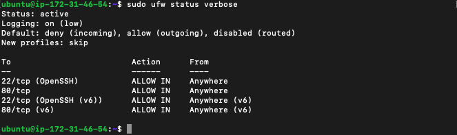
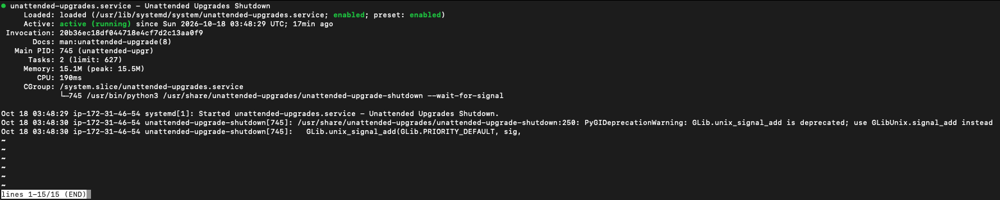

---

## 6. Users and Groups

### What I did in this step
In this step, I created users and groups to model a university setup with faculty, students, and IT staff.

```bash
sudo groupadd faculty
sudo groupadd students
sudo groupadd itstaff
sudo adduser prof_lee
sudo adduser student1
sudo adduser abel
sudo usermod -aG faculty prof_lee
sudo usermod -aG students student1
sudo usermod -aG itstaff,sudo abel
```

| User | Role | Groups | Admin? |
|---|---|---|---|
| `prof_lee` | Faculty | `faculty` | No |
| `student1` | Student | `students` | No |
| `abel` | IT staff | `itstaff`, `sudo` | Yes |

### Understanding groups
Instead of giving permissions to each person one by one, I gave them to groups. That way when a new student shows up, I just add them to `students` and they get the right access. Only IT staff got admin (`sudo`) rights, since nobody else needs them.

One thing to watch out for is the `-a` in `usermod -aG`. It means append. Without it, the command replaces all of a user's groups, which could accidentally remove their access to other things.

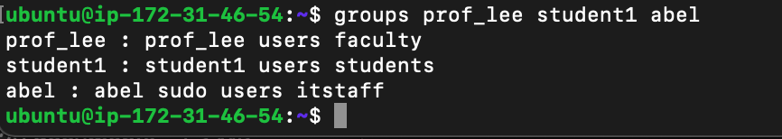

---

## 7. Shared Folder Permissions

### What I did in this step
In this step, I set up a course folder where faculty can add and edit files, and students can only read them.

```bash
sudo mkdir -p /srv/courses
sudo chown root:faculty /srv/courses
sudo chmod 2775 /srv/courses
```

### Understanding the permissions
`775` means the owner and the `faculty` group have full access, and everyone else (students) can only read. The `2` at the front sets something called the setgid bit. It makes any new file in the folder belong to the `faculty` group automatically, even if one specific professor created it.

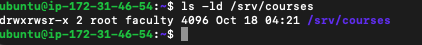

### Testing access
I tested each user with `sudo -u`, which runs a command as a different user. This is also how you would troubleshoot an "I can't open this" ticket.

| Test | Result |
|---|---|
| Faculty creates `syllabus.txt` | ✅ Allowed |
| Student views the folder | ✅ Allowed |
| Student tries to create a file | ❌ Permission denied |
| Group on the new file | `faculty` (setgid worked) |

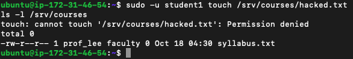

My first try at testing had a couple of mistakes in it. I used a group name where `sudo -u` needed a username, and I typed `ls -1` (the number one) instead of `ls -l`. I fixed both and reran the tests above.

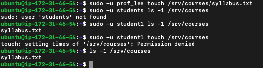

---

## 8. Running a Web Server

### What I did in this step
In this step, I installed Nginx and put up a simple status page.

```bash
sudo apt install nginx -y
echo "<h1>Ubuntu Lab Server: Online</h1><p>Managed by Abel Mesfin</p>" | sudo tee /var/www/html/index.html
systemctl status nginx
curl localhost
```

### Understanding services
Nginx is a web server that runs in the background as a service. `systemctl status` shows whether it's running. I used `sudo tee` to write the page because a normal `>` redirect doesn't work with `sudo`. Running `curl localhost` let me test the page from the server itself before involving the network.

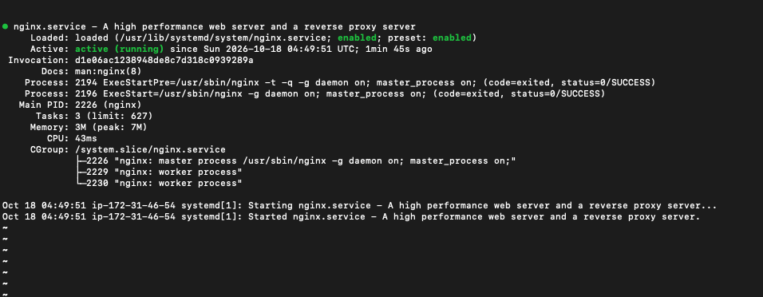
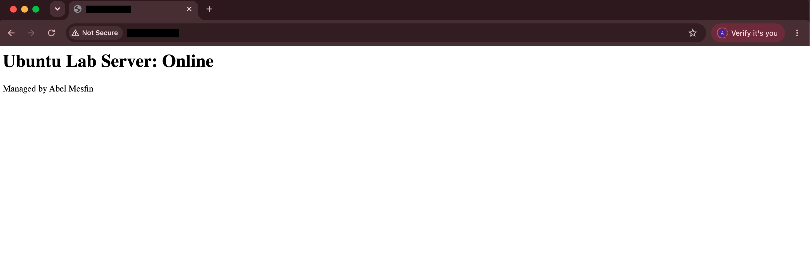

### Troubleshooting: the page wouldn't load
The page worked on the server but not in my browser. When I ran `curl` from my Mac I got "Connection timed out." A timeout means something is quietly dropping the traffic (usually a firewall), while "connection refused" would have meant the server was reached but nothing was listening.

That pointed me to the AWS security group. I had opened port 80 in UFW but not in AWS. After adding an HTTP rule for my IP, the page loaded.

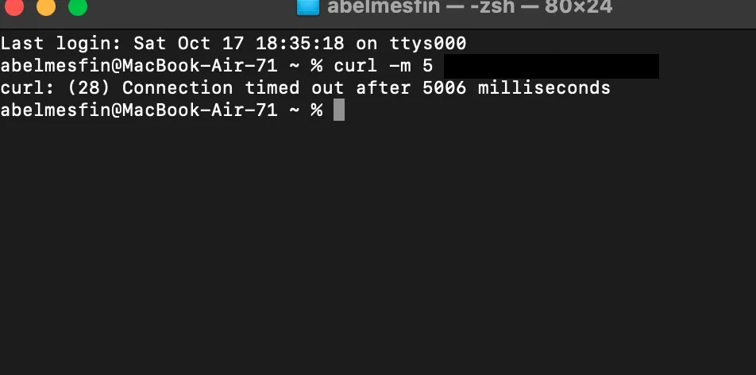
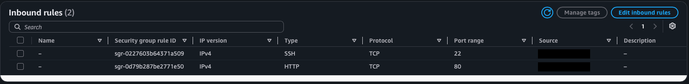
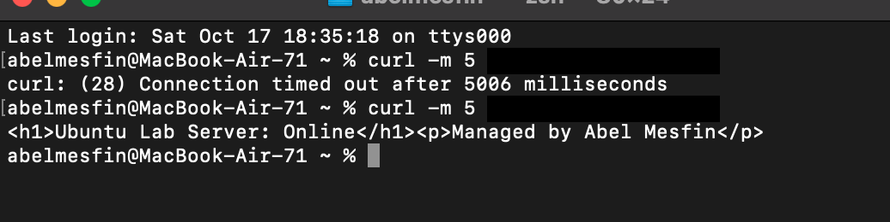

---

## 9. Health Check Script

### What I did in this step
In this step, I wrote a Bash script that checks on the server and scheduled it to run every day with cron.

```bash
#!/bin/bash
echo "=== Health check: $(date) ==="
echo "Uptime: $(uptime -p)"
echo "Disk:"; df -h /
echo "Memory:"; free -h
systemctl is-active --quiet nginx && echo "Nginx: running" || echo "Nginx: DOWN"
echo "Updates waiting: $(apt list --upgradable 2>/dev/null | grep -c upgradable)"
```

Cron schedule:
```
0 8 * * * /home/ubuntu/healthcheck.sh >> /home/ubuntu/health.log
```

### Understanding cron
Cron is the scheduler built into Linux. This line runs the script every day at 8:00 and adds the results to `health.log`, so there's a history to look back on. The server runs on UTC, so that's actually 1:00 AM my time, which works fine for a maintenance task.

### What the first report showed
- Disk was 40% full and memory looked healthy.
- There were already 3 new updates waiting, only about an hour and a half after I fully updated it. That showed me why automatic updates and regular checks matter.
- The server has no swap space set up, which could be a problem on a machine with only 1 GB of memory.

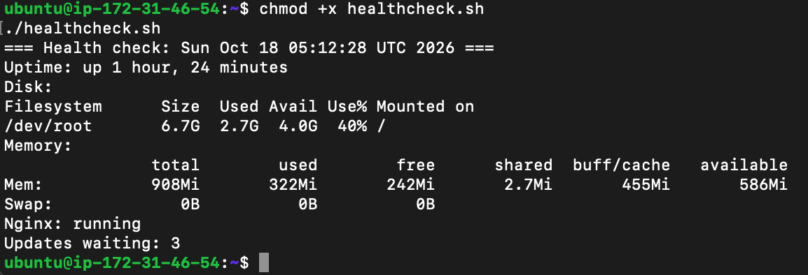
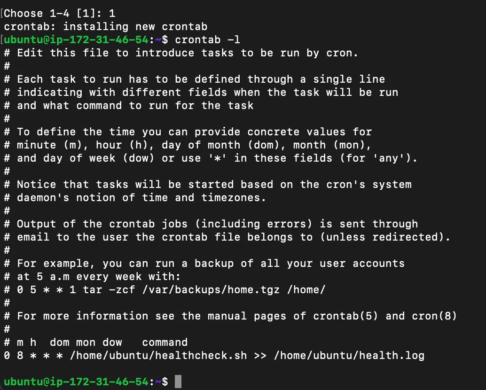

---

## 10. Breaking Things on Purpose

To practice troubleshooting, I broke two things on purpose and fixed them the way I would handle a support ticket: reproduce the problem, figure out the cause, fix it, then confirm it worked.

### Ticket 1: "The website is down"
I stopped Nginx to act like it crashed. My health check script caught it and showed `Nginx: DOWN`. Then I checked `systemctl status nginx` and the logs with `journalctl -u nginx`, which showed exactly when it was stopped. I started it back up with `sudo systemctl start nginx` and the health check showed it running again.

When I went to confirm the site was back, my `curl` timed out. It turned out I had run it on the server instead of my Mac. The security group only allows my Mac's IP, so it blocked the server from reaching its own public address. Running it from my Mac worked fine.

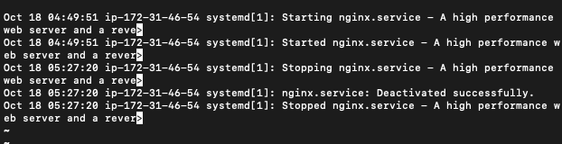
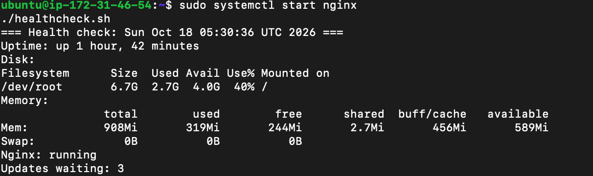

### Ticket 2: "A student can't open course files"
I changed the folder permissions to `2770`, which removes access for everyone outside of faculty. Running `ls` as `student1` gave "Permission denied." Checking with `ls -ld` showed `drwxrws---`, so "others" had no access at all, and students depend on that. I set it back to `2775` and student1 could see the files again.

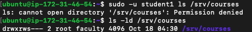
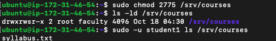

---

## Key Takeaways

**Linux is case-sensitive.**
I created a group called `ITstaff` and then tried to use `itstaff`, which didn't work because Linux saw them as two different groups. I later renamed it to lowercase with `groupmod` to keep things consistent.

**Spaces matter in commands.**
I typed `usermod -aG ITstaff ,sudo abel` with a space before the comma and it just printed the help screen. A list of groups can't have spaces in it.

**Error messages tell you where to look.**
"Timed out" and "connection refused" mean different things. Paying attention to the exact error got me to the actual problem a lot faster than guessing.

**Security is layered, so check every layer.**
A port has to be open in both the AWS security group and UFW. When I added the HTTP rule in AWS, I accidentally replaced my SSH rule instead of adding a new one. My SSH session kept working because AWS doesn't cut off connections that are already open, so I almost didn't notice. I caught it when reviewing the rules and added SSH back. Now I make sure to look over the whole rule list after any change.

**Where you run a test matters.**
`curl localhost` on the server tests whether the service works. `curl` from my Mac tests the whole path over the internet. Mixing those up gave me a confusing result.

**Always test permissions.**
Setting permissions is only half the job. Actually running commands as each user is what proved the setup worked.

---

## What I'd Improve Next

- Let faculty edit each other's files. Right now new files are only readable by the group because of Ubuntu's default umask.
- Add swap space so the server is less likely to crash if it runs low on memory.
- Set up HTTPS with a real domain and a free certificate.
- Have the health check send an alert when something is down instead of only writing to a log.

---

## Repository Structure

```
.
├── README.md
└── screenshots/
```

*IP addresses and account IDs have been redacted from screenshots. The server is stopped when not in use.*
